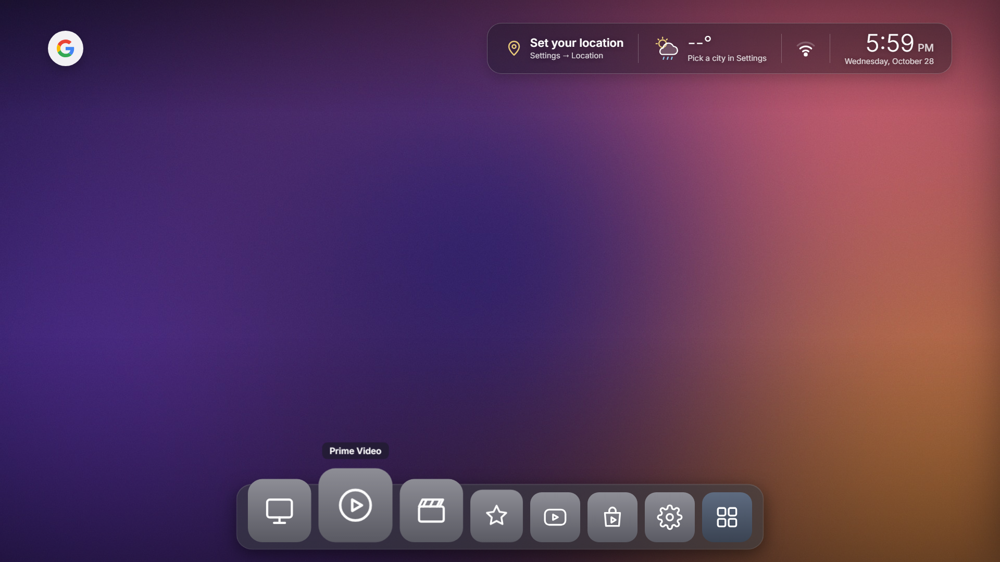
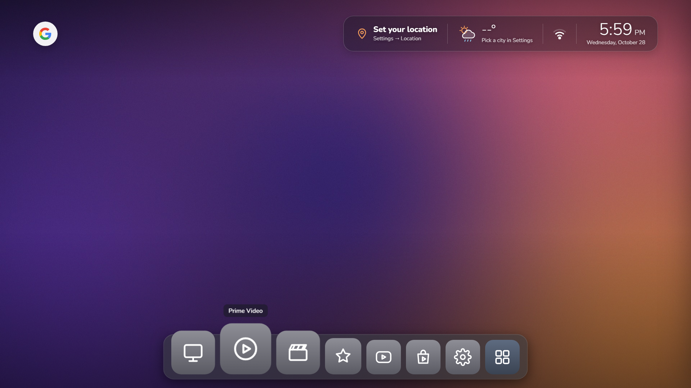
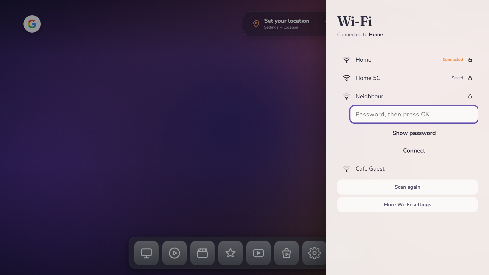
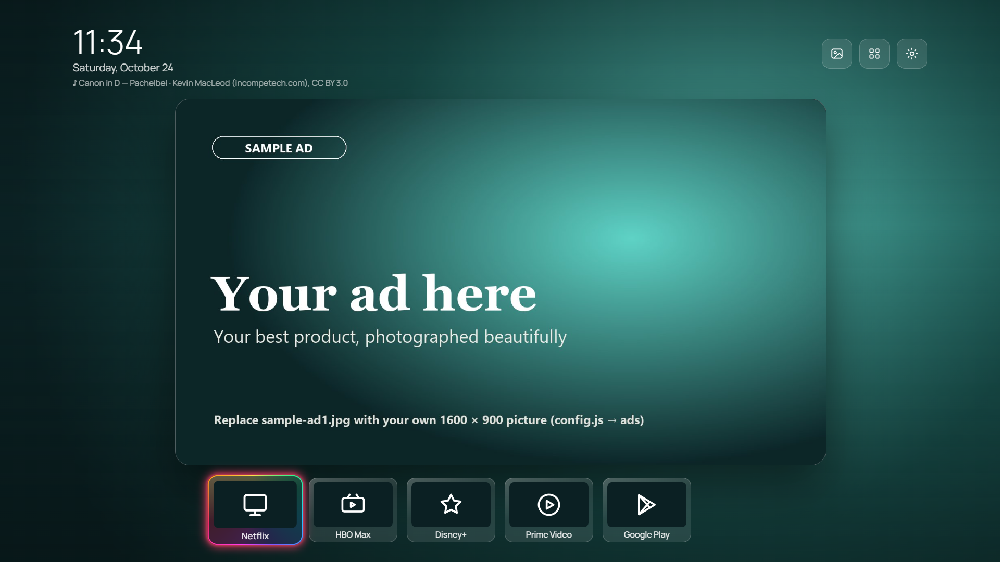
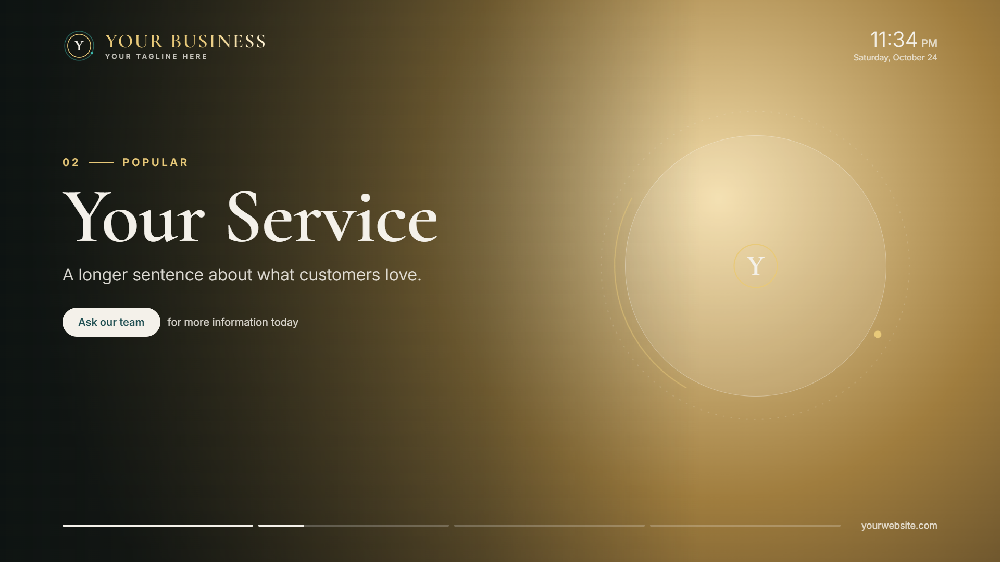
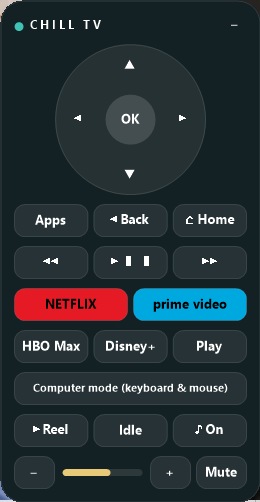
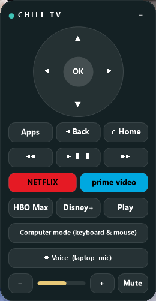
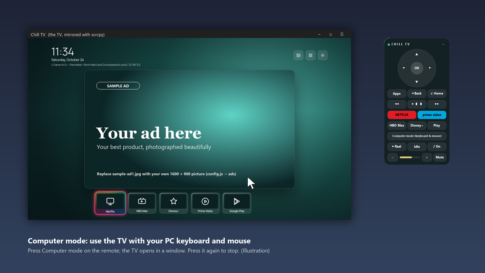

# Chill TV

Calm, good-looking home screens for Android TV boxes (Mi Box, Chromecast with Google TV, Android TV sets), with no ads.
There are two styles, plus a remote for your computer.

| | **Chill TV Home** | **Chill TV Showcase** |
|---|---|---|
| For | A family TV | A shop, salon, office or waiting room |
| Home screen | Clean, like macOS: your pictures as a slowly fading wallpaper, weather and clock on top, a macOS-style app dock that magnifies and opens apps with the genie effect, your Google profile picture, a Wi-Fi drawer to join networks | Your ads in a big centre card, app dock, clock |
| When idle | Clock screensaver with an alarm | Full-screen slides about your business |
| Extras | Voice assistant with a name you choose ("Max, open Netflix"), alarm that wakes the TV, two themes | Quiet classical background music, a reel of your videos |
| Remote | Mac, Windows and browser remote, with keyboard-and-mouse Computer mode and voice commands through the laptop's mic ("TV, open Netflix") | The same, plus Reel, Idle and Music buttons |
| You set | Home name, assistant name, location (all in Settings on the TV) | Business name, tagline, website, slides, ads, music, reels, location (in `config.js`) |

## Easy install (no coding)

1. Download **[ChillTV-USB-Kit.zip](https://github.com/AlimangoStudio/chill-tv/releases/latest/download/ChillTV-USB-Kit.zip)** and unzip it.
2. Copy the `ChillTV-USB-Kit` folder to a USB stick and follow `START-HERE.html` inside it.

The kit holds both apps, a step-by-step guide, a Windows helper that makes Chill TV the home screen over Wi-Fi (with an
Undo), and the Windows remote. Every TV makes its own remote pairing code on first start, shown in Chill TV Home's
Settings › Remote or behind the phone icon in Showcase. To build the kit yourself: `installer\make-usb-kit.ps1`.

## Screenshots

**Chill TV Home** (teal and pastel themes)





**Chill TV Showcase**: home screen with your ads, and the idle showcase




**Remote** (Windows; the Mac one looks the same): a small circle that floats on top of your other windows and opens into this remote

 

Left: connected to Showcase. Right: connected to Home, where the Reel, Idle and Music buttons are hidden.

**PC control**: Computer mode puts the TV in a window, so you can type logins with your keyboard and click with your mouse



## Step 0: clean the TV (optional, recommended)

[`tv-cleanup/`](tv-cleanup/README.md) switches off the ad services, telemetry and preloaded bloat over Wi-Fi. It has tested lists for 261 Android TV models: TCL, Sony, Xiaomi / Mi Box, Philips, Hisense, Fire TV, Chromecast, Shield and more. Nothing is uninstalled, and a restore script undoes every step. The lists and tools come from [CleanYourTV](https://github.com/Gathin23/cleanyourtv) (MIT).

LG (webOS) and Samsung (Tizen) TVs aren't Android, so neither Chill TV nor the cleanup tools run on them. Plug an Android TV box such as a Mi Box into them instead.

## Build and install

You need the Android SDK (build-tools 34.0.0 and platform android-34), JDK 17 and `adb`. The build scripts are PowerShell and need no Gradle.

```powershell
cd home        # or: cd showcase
.\build.ps1    # makes ChillTV-Home.apk (or ChillTV-Showcase.apk)
adb connect <TV-IP>:5555
adb install -r ChillTV-Home.apk
```

On the TV, press Home and choose Chill TV as the home app.

The first build makes your own `signing.keystore`. Keep it, because updates must be signed with the same key. It is kept out of git.

### Chill TV Home: settings on the TV

Open the settings panel from the home screen:
- **Names**: your home's name (shown on the clock screensaver) and the assistant's name. The assistant's name is the word you say before a command.
- **Location**: pick a city or type one. It sets the weather and the time zone.
- **Alarm**: set a wake-up time. The TV turns on and rings.
- **Theme**: Teal or Pastel.

**Wallpapers**: Home shows the pictures listed in `WALLPAPERS` at the top of the script in [`home/app/assets/index.html`](home/app/assets/index.html), full screen, with a soft 2.5 s fade every 30 s (`WALL_SECONDS`). Two calm gradients are included (`wall1.jpg`, `wall2.jpg`). To use your own photos, put 1920×1080 JPEGs in `home/app/assets/`, list them in `WALLPAPERS`, and build. Use pictures you own or may share. Keep them 1920×1080 even for 4K files: most TV boxes show the home screen at 1080p, and smaller files fade more smoothly.
The top bar holds the Google G, the USB button (only while a drive is plugged in) and the location, weather, Wi-Fi and clock panel; the remote's mic button still reaches the assistant.

**The dock** works like the macOS dock ([mac-genie](https://www.ui-layouts.com/components/mac-genie)): square app icons that grow as the focus passes over them, a dot under apps that are running, and the genie effect. An app opens out of its icon as a window, and pressing Home pours it back into the icon.

**Wi-Fi drawer**: press Up from the dock, then Right to the Wi-Fi icon (its bars show the signal; a slash means offline), then OK. A drawer slides in from the right:
- **Location off** (the default on most boxes, and the privacy-friendly choice): **Type a network name**, then the password (OK opens the TV keyboard, OK again moves on), then **Connect**. Android hides network names from apps while Location is off, so the drawer can't list nearby networks or switch between networks the TV already saved; use **More Wi-Fi settings** for those.
- **Location on**: the drawer lists nearby networks, strongest first; pick one and type its password.

If the password is wrong, the drawer says so after about 30 seconds, removes the attempt, and the TV goes back to its previous network. Passwords go straight to Android and are never logged. Joining Wi-Fi from an app only works for apps that target Android 9 (API 28), which is why Home targets API 28.

**Google picture**: select the G and press OK to pick one of the TV's Google accounts (or add one). Google asks once for permission to read the basic profile. The G then becomes that person's profile picture, refreshed once a day. Pressing OK on the picture opens the TV's account settings. The e-mail address and the sign-in token are never shown or logged.

Google only gives the picture to a registered app, so a self-build needs a free Android OAuth client of its own:
1. In [Google Cloud console](https://console.cloud.google.com/), create a project, open **Google Auth Platform**, and fill in the app name, support e-mail and **External** audience.
2. Under **Clients**, create an **Android** client with package name `app.alimango.chilltv.home` (or yours, if you renamed it) and the SHA-1 of your `signing.keystore`: `keytool -list -v -keystore home/signing.keystore`.
3. While the app is in **Testing**, add each Google account that will sign in on the TV under **Audience > Test users** (up to 100). Publishing it instead needs a homepage and a privacy-policy address.

Without a client the G stays a plain G after the account is picked. Settings can take a few minutes to reach Google.

### Chill TV Showcase: your business in `config.js`

Edit [`showcase/app/assets/config.js`](showcase/app/assets/config.js), put your pictures, videos and music in `showcase/app/assets/`, then build.
- **brand**: name, tagline, logo letter, website, and the call to action on each slide.
- **location**: city, latitude and longitude for the weather. Leave them empty to show the clock only.
- **slides**: the idle showcase text.
- **idlePictures**: use your own full-screen 1920×1080 slides instead of the text slides.
- **ads**: 16:9 pictures (1600×900 is ideal) for the centre card. The three `sample-ad` pictures are placeholders to replace.
- **reels**: vertical videos for the reel screen. With no reels, the reel tile is hidden.
- **music**: six calm classical pieces are included (credits below). Add your own, or remove them.

## The remote (Home and Showcase)

Both apps run a small remote server on the TV (port 8765). Every request needs a secret key.
- **The key**: the first build makes a random key and saves it in `remote-key.txt` (in `home/` or `showcase/`). The key in the source stays `CHANGE-ME`. A TV built with that placeholder refuses every remote request.
- **Browser**: open `http://<TV-IP>:8765/?k=<key>` on any phone or computer for a simple remote page.
- **Windows**: run `remote\windows\build.cmd`. It uses the C# compiler built into Windows, so there's nothing to install. Run `ChillRemote.exe`, then enter the TV address and key. The key is stored encrypted for your Windows user only.
- **Mac**: run `bash remote/mac/build-mac.sh` (macOS 12 or newer, Xcode Command Line Tools).
- **Keys in every app (Mac)**: the launcher can only press keys on its own screen. When the Mac has adb (`brew install --cask android-platform-tools`) and the TV allows it (network debugging on, "Always allow" once), the Mac remote's arrows, OK and Back press real keys in whichever app is in front, Netflix included. Without adb they go to the launcher as before.
- **Type on the TV (Mac)**: select a search or sign-in field on the TV, press **⌨ Type on the TV** and type on the Mac. Needs the same adb access. Plain letters, numbers and symbols only.
- **Renamed Mac install**: `NAME="…" BUNDLE_ID=… bash remote/mac/build-mac.sh`. Optional settings (`defaults write <bundle id> …`): `brand` (the name on the remote), `adbPath` and `adbHome` (an adb and the HOME holding the key the TV already allowed).
- **Computer mode** needs [scrcpy](https://github.com/Genymobile/scrcpy):
  - Windows: unzip it into `remote\windows\scrcpy\`.
  - Mac: `brew install scrcpy`.
  - On the TV, turn on USB/network debugging and choose "Always allow" the first time.
  - Video apps (Netflix and others) show black in the window because they block screen capture. Use their "Sign in with code" instead.
- **Voice** (Windows and Mac): press **◉ Voice** and talk to the laptop. Start every command with "TV", so ordinary talk in the room is ignored:
  - "TV, open Netflix" (also Prime Video, HBO Max, Disney Plus, Google Play), "TV, go home", "TV, back", "TV, apps"
  - "TV, pause" / "play", "TV, fast forward", "TV, rewind", "TV, next"
  - "TV, volume up" / "volume down" / "mute"
  - "TV, up" / "down" / "left" / "right" / "OK"; on Showcase also "TV, reel", "TV, idle", "TV, music on" / "music off"
  - "TV, stop listening" turns Voice off.

  The circle's ring turns gold while it listens, also when the remote is folded up, and Voice stays on next time you start the remote. Windows uses its own offline speech recognizer (English); the Mac uses Apple's, on the Mac itself where the Mac supports it, and asks once for the microphone and speech recognition. Only the command goes to the TV, never the audio.

The remote is plain HTTP, so keep it on your own network or a private VPN such as Tailscale. Don't expose port 8765 to the internet.

Connected to a Home TV, the remote hides the Showcase-only buttons (Reel, Idle, Music). The remote's Back button uses the Home app's volume-bar accessibility service, so switch that on once in the TV's Settings → Accessibility. On Showcase it's the "Chill TV remote (Back button)" service.

## Credits and licences

- **Code**: MIT (see [LICENSE](LICENSE)).
- **Fonts** (Home): Cormorant Garamond, Fraunces and others, under the SIL Open Font License.
- **Music** (Showcase), shown on screen when each track starts:
  - *Canon in D*: Pachelbel, performed by Kevin MacLeod ([incompetech.com](https://incompetech.com)), licensed CC BY 3.0
  - *Gymnopédie No. 1*: Satie, public domain (CC0)
  - *Clair de lune*: Debussy, Laurens Goedhart, public domain
  - *Gymnopédie No. 2*: Satie, Michael Laucke, public domain
  - *Gnossienne No. 1*: Satie, La Pianista, public domain
  - *Nocturne Op. 32 No. 2*: Chopin, Olga Gurevich (Musopen), public domain
- **TV cleanup** (`tv-cleanup/`): tools and model lists from [CleanYourTV](https://github.com/Gathin23/cleanyourtv), © Gathin, MIT (see `tv-cleanup/LICENSE-cleanyourtv`).
- **Weather and city search**: [Open-Meteo](https://open-meteo.com) (free, no key).
- Netflix, Prime Video, HBO Max, Disney+ and Google Play are trademarks of their owners. Chill TV only opens their apps.

## Related

- [CleanYourTV](https://github.com/Gathin23/cleanyourtv) by Gathin is the source of `tv-cleanup/` (MIT). It also has its own Apple TV-style launcher, themes and add-ons.

Made by Alimango Studio.
